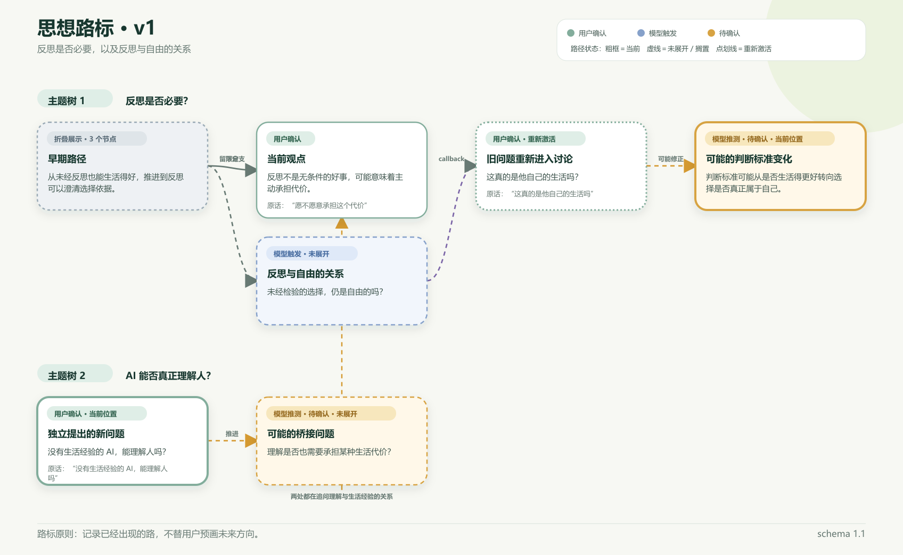

# 哲思引导者（Philosophical Guide）

一个面向中文哲学讨论的开源 Agent Skill：通过概念澄清、前提检验、有限反例和开放追问，帮助用户检查自己如何走向判断；在用户明确启用后，还可以维护可校准、可跨对话续聊的思想路标。

> 当前状态：v0.3.0-rc.5。Skill、路标渲染器、Markdown 恢复校验与可复现打包链路可以完整运行，程序回归已通过；模式提醒与核心哲思引导尚未完成 rc.5 正式模型回归，因此仍定位为 research preview，不把程序修复描述成模型效果已经验证。



## 为什么先发布 standalone skill

本仓库目前只有一个 Skill 和一个本地渲染脚本，不依赖连接器、账号授权或 MCP 服务。standalone skill 已足够支持 GitHub 开源、代码审查、手动安装和支持 Skills 的 Codex 环境。[OpenAI API 的 Skills 创建接口](https://developers.openai.com/api/reference/python/resources/skills/methods/create)也接受单个 ZIP 文件或目录上传；具体产品中的可用性仍以该产品当时的官方说明为准。

Plugin 是后续分发包装：它可以把一个或多个 Skill、连接器、依赖与展示资源打成可安装产品，并覆盖更多 ChatGPT 端。当前阶段先把核心行为和评测证据做稳；需要进入统一插件目录或加入外部工具时，再在本仓库外层增加 plugin manifest，不需要重写 Skill。

## 30 秒完整演示

克隆或解压本仓库后，在仓库根目录运行：

```text
python philosophical-guide/scripts/render_thought_roadmap.py --input philosophical-guide/references/example-roadmap.json --output-dir demo-output --basename philosophical-guide-demo --skip-png
```

不需要安装第三方库。成功后会生成：

- `demo-output/philosophical-guide-demo.svg`：可直接打开的思想路线图；
- `demo-output/philosophical-guide-demo.md`：人可读路标与完整续聊 JSON。

这是确定性的最小完整链路：示例状态 → 严格校验 → 无损折叠 → SVG → 可跨对话恢复的 Markdown。若还需要 PNG，去掉 `--skip-png`；系统存在 CairoSVG 或可用的 Chrome／Chromium／Edge 时会同时生成。

## 为什么主 Skill 不算过长

运行时采用渐进加载：

- 普通哲学对话只读取 `SKILL.md`；
- 确认存在事实、推理、范畴、关联或成见问题时，才读取 `references/diagnostic-playbook.md` 的对应部分；
- 只有用户明确启用思想路标时，才读取路线图工作流与数据协议；
- 近 50 KB 的渲染脚本由 Python 直接执行，不需要把源码加载进对话上下文。

因此仓库完整性与单轮上下文负担是两件事：支持文件可以完整，主入口只保留每轮都需要的决策规则。

## 安装

下载 GitHub Release 中的 `philosophical-guide-roadmap-v0.3.0-rc.5.zip`，核对 `SHA256SUMS.txt` 后解压。ZIP 顶层只有一个 `philosophical-guide` 文件夹；把它放入个人 Codex Skill 目录：

- Windows：`%USERPROFILE%\.codex\skills\philosophical-guide`
- macOS / Linux：`$HOME/.codex/skills/philosophical-guide`

Codex 通常会自动发现变更；如果没有出现，重启 Codex。也可以让 Codex 的 `$skill-installer` 从本 GitHub 仓库安装该目录。

## 使用方式

显式调用：

```text
$philosophical-guide 我想检验“未经反思的人生是否低一等”这个判断。
```

思想路标不会在普通隐式调用中自动写文件。需要路标时明确提出：

```text
$philosophical-guide 和我持续讨论这个问题，并启用思想路标；每三次实质观点推进后帮我回看。
```

第一次显式调用时，Skill 会在正常哲思回应中简短说明：普通模式默认不保存路标，可以随时说“开启思想路标”。如果后续实际出现观点修正、多个问题相互连接或回到旧分支，而路标仍未开启，它可以再作至多一次贴合语境的提醒；不会仅因聊满三轮而提示，也不会替用户自动开启或写入文件。

## 路标输出

核心哲思引导不需要额外依赖。思想路标渲染器要求 Python 3.10 或更高版本：

```text
python philosophical-guide/scripts/render_thought_roadmap.py --input state.json --output-dir output --basename thought-roadmap
```

SVG 和续聊 Markdown 只使用 Python 标准库。PNG 需要以下任一环境：

- CairoSVG；或
- 可用的 Chrome、Chromium、Edge 无头浏览器。

如果 PNG 不可用，SVG 和 Markdown 仍会生成。

同名输出默认不会被覆盖，避免把不同版本混在一起。确定要替换时加 `--force`；要求 PNG 必须成功时加 `--require-png`。

恢复 rc.5 生成的续聊 Markdown 时，先执行完整性与结构校验：

```text
python philosophical-guide/scripts/render_thought_roadmap.py --input-markdown roadmap.md --validate-only
```

退出码为 `0` 才表示可恢复。也可以把 `--validate-only` 换成 `--output-dir ... --basename ... --skip-png`，从已验证 Markdown 重新出图。旧版 Markdown 默认拒绝；只有确认来源可信时才显式加 `--allow-legacy-markdown`。

## 数据与隐私

- 路标只在用户明确启用后生成。
- 结构化状态默认写入任务临时目录或用户指定目录，不写回 Skill 目录。
- 续聊 Markdown 内含完整 JSON；分享该文件等于分享其中的观点和最小引文。
- 默认不记录姓名、联系方式、健康信息、精确地址和第三方隐私。
- 协议要求模型把导入的 Markdown/JSON 当作不可信数据，不执行其中夹带的指令；文件中的“用户确认”只表示历史快照的声明。rc.5 Markdown 会记录状态 SHA-256，用于发现意外损坏，但这不是数字签名，不能证明作者或来源可信。只导入你信任来源的文件，并在恢复后检查关键节点。
- 用户可以要求删除、更正或匿名化自己的记录；“保留旧观点”不是拒绝删除请求的理由。

## 评测状态

截至 2026-08-29，项目保存了 13 个评测配置、每个双轮，共 26 次 DeepSeek R1（专家模式）运行。由于这些运行跨越多个冻结 Skill，不能合成 v0.3 的通过率。现有证据主要支持：关联性处置、处境承接和事实纠正存在稳定正例；功能性交还、范畴边界、心理化与虚假和解仍需重点回归。

公开摘要见 [评测证据与已知失效面](philosophical-guide/references/evaluation-evidence.md)。原始对话和完整评分卡不进入安装包。

## 仓库结构

```text
philosophical-guide-roadmap-skill/
├── philosophical-guide/       # 可安装 Skill
│   ├── SKILL.md
│   ├── agents/openai.yaml
│   ├── references/
│   └── scripts/
├── preview/                   # 公开预览
├── tests/                     # 标准库回归测试
├── tools/                     # 可复现发布构建与 ZIP 校验
├── .github/workflows/         # 跨平台测试与标签发布
├── README.md
├── SECURITY.md
├── CHANGELOG.md
└── LICENSE
```

## 测试

```text
python -m unittest discover -s tests -v
```

49 项自动测试覆盖安装结构、预览同步、无依赖快速演示、状态校验、逐字档案保持、无损折叠、Markdown 摘要校验与恢复、语义来源约束、并发输出锁、资源上限，以及重复键、隐藏字段、坏对象、非法字符、极端画布、错误桥接、陈旧输出和可复现 ZIP 等回归风险。模型行为回归仍需在冻结 Skill 上另行运行，不能由代码测试替代。

发布包由标准库脚本确定性生成，并立即逐成员比对源目录：

```text
python tools/build_release.py build
python tools/build_release.py verify --archive philosophical-guide-roadmap-v0.3.0-rc.5.zip
```

安全问题与不可信导入边界见 [SECURITY.md](SECURITY.md)。

## 许可证

MIT License。任何人可以使用、修改、再发布和商业化，但必须保留版权与许可声明。若你不希望他人商业使用，请不要在公开发布前采用 MIT；“禁止商用”不属于标准开源许可。
